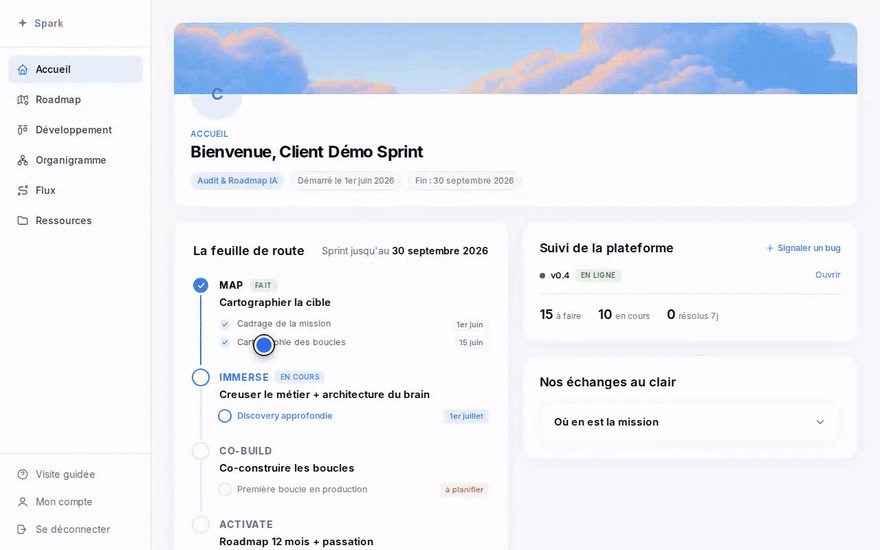

# silex-spark

Plugin Claude / Codex / OMP pour l’**API Spark** : tickets Pilotage, board Tâches, ressources, journeys, organigramme, accueil, projets et relations. Authentification par PAT personnelle `spu_…` (droits du compte).

Produit : [https://spark.gosilex.com](https://spark.gosilex.com)

| Skill | Rôle |
| --- | --- |
| `spark-setup` | Écrire `~/.config/silex/spark.env` (URL + PAT) |
| `spark-tickets` | Tickets, comments, tasks board, resources/journeys/org/accueil, projets, liens, GitHub |

## Miroir public

**SoT = dépôt privé `go-silex/spark`, dossier `plugins/silex-spark/`.**  
Ce dépôt GitHub (`go-silex/silex-spark`) est un **miroir en lecture seule**, synchronisé depuis `main` (prod). Issues et PRs ne sont pas le canal de contribution — voir `CONTRIBUTING.md`.

Chaque snapshot publié porte une version `mirror-<SHA-256>` dérivée du contenu public, hors métadonnées Git à toute profondeur, puis inscrite dans les manifestes et catalogues des différents clients. Un changement public invalide ainsi le cache installé ; une relance sans changement public conserve la même version. Le contenu est synchronisé même lorsque sa taille et sa date sont inchangées. Les versions sources restent inchangées.

Le publisher synchronise les fichiers réguliers par remplacement, puis remplace les métadonnées par un nouveau fichier, pour ne pas modifier les octets ou permissions d'une source ou d'un fichier externe partageant son inode. Les métadonnées Git (`.git`), même imbriquées, ne peuvent pas être cibles du stamping. Un dossier devenu interne est retiré du snapshot suivant, sans effacer l’historique Git déjà publié. La racine `SRC` est résolue une seule fois, y compris via lien symbolique, pour le scan et la copie. Les chemins marqués et les chemins résolus de métadonnées sont traités littéralement, y compris les métacaractères, antislashs et LF finaux.

## Install (Claude Code)

```bash
claude plugin marketplace add go-silex/silex-spark
claude plugin install silex-spark@silex-spark --scope user
claude plugin marketplace update silex-spark
claude plugin update silex-spark@silex-spark
```

L’id d’install client est **`silex-spark@silex-spark`**. `update silex-spark` seul échoue (« Plugin not found ») — toujours l’id complet.

### extraKnownMarketplaces (optionnel)

Dans `.claude/settings.json` :

```json
{
  "extraKnownMarketplaces": {
    "silex-spark": {
      "source": {
        "source": "github",
        "repo": "go-silex/silex-spark"
      },
      "autoUpdate": true
    }
  },
  "enabledPlugins": {
    "silex-spark@silex-spark": true
  }
}
```

## Install (OMP)

```bash
omp plugin marketplace add go-silex/silex-spark
omp plugin install silex-spark@silex-spark --scope user
omp plugin marketplace update silex-spark
omp plugin upgrade silex-spark@silex-spark
```

La mise à jour OMP ci-dessus est explicite ; `autoUpdate` dans la configuration Claude ne règle pas OMP. Après une mise à jour, recharger les plugins ou redémarrer la session pour activer la nouvelle copie.

## Config machine

### Secrets (PAT)

**Pourquoi.** Les agents parlent à Spark avec **tes** droits (pas une clé d’app M2M `spk_`). Une PAT `spu_…` se génère dans l’UI, s’affiche **une seule fois**, et vit hors git.

**Comment.** Spark → **Mon compte** (menu gauche) → **Clés API** → libellé → **Générer une clé** → **Copier**.



Puis :

```bash
mkdir -p ~/.config/silex && chmod 700 ~/.config/silex
cat > ~/.config/silex/spark.env <<'EOF'
SPARK_URL=https://spark.gosilex.com
SPARK_USER_API_KEY=spu_…
EOF
chmod 600 ~/.config/silex/spark.env
```

Ordre PAT : env `SPARK_USER_API_KEY` → `spark.env` → `spark-user-api-key` → BW `gosilex/spark-user-api-key`.

### Client / projet (non secret)

| Fichier | Rôle |
|---------|------|
| `./config/spark.yml` | Défaut workspace (équipe, commitable) |
| `~/.config/silex/spark.yml` | Défaut machine |
| `config/spark.example.yml` | Template |

```bash
bash "$SCRIPT" config init --client acme [--project App]   # projet
bash "$SCRIPT" config init --client acme --global            # machine
bash "$SCRIPT" config show
bash "$SCRIPT" tickets list   # client implicite
bash "$SCRIPT" tickets get 42
```

Priorité : CLI / `--client` → `SPARK_CLIENT` → config projet → spark.yml global.

## CLI (agents)

Les skills résolvent `spark.sh` **uniquement** via `CLAUDE_PLUGIN_ROOT` (plugin marketplace installé). Pas de fallback vers un clone git local.

Pour `tickets delete|demote-preview|demote` et `ideas get|delete|promote`, une erreur de transport interrompt la commande sans rejeu ni retrait du client sélectionné.

Ces commandes Pilotage acceptent `'#42'` comme `42` ; les identifiants des commandes de tickets, commentaires et utilisateurs ajoutées ici restent un seul segment d'URL. Les segments de traversée `.` et `..` sont refusés avant tout appel.

Les valeurs des filtres sont encodées comme des données, y compris les espaces, accents et caractères réservés ; leur validation et les restrictions de droits restent inchangées.

```bash
: "${CLAUDE_PLUGIN_ROOT:?installer silex-spark@silex-spark}"
SCRIPT="${CLAUDE_PLUGIN_ROOT}/skills/spark-tickets/scripts/spark.sh"

bash "$SCRIPT" meta
bash "$SCRIPT" meta-links
bash "$SCRIPT" meta-projects
bash "$SCRIPT" tickets list acme          # chaque ticket.links inclus
# Create : défaut staff/agent = **interne** (pas de notif client).
# Ticket visible client / notif client → **--public** obligatoire.
# Priorité dès le create → --priority p0|p1|p2|p3 (sinon p2).
bash "$SCRIPT" tickets create acme "Tech debt …" "…"           # interne (défaut)
bash "$SCRIPT" tickets create acme "Bug UI budget" "…" --public # visible client
bash "$SCRIPT" tickets create acme "Hotfix images" "…" --public --priority p0
bash "$SCRIPT" tickets patch <id> '{"priority":"p1"}'
# Discussion (comments = fil ticket Pilotage)
bash "$SCRIPT" tickets get <id|ref> [--client slug]
bash "$SCRIPT" tickets comments list <id>
bash "$SCRIPT" tickets comments add <id> "Message" [--parent N] [--internal]
bash "$SCRIPT" resources list acme
# Type de document par défaut : Documentation. Types canoniques : Cadrage, Livrables, Comptes-rendus, Présentations, Documentation, Devis, Factures, Contrats & NDA ; un type libre reste accepté.
bash "$SCRIPT" resources create acme "Note de cadrage" "https://…" --category Cadrage
bash "$SCRIPT" resources patch <id> '{"category":"Livrables"}' --client acme
bash "$SCRIPT" journeys list acme
bash "$SCRIPT" journeys create acme "Onboarding"
bash "$SCRIPT" orgchart get acme
bash "$SCRIPT" orgchart put acme '{"nodes":[],"edges":[]}'
bash "$SCRIPT" accueil get acme
bash "$SCRIPT" accueil patch acme '{"recap":"## MAJ\n"}'
bash "$SCRIPT" tasks list acme
bash "$SCRIPT" tasks create acme "Nouvelle tâche" "détail"
bash "$SCRIPT" tasks reject <cuid> --reason "Doublon" --duplicate 42 --client acme
bash "$SCRIPT" tasks demote-preview <cuid> --client acme  # lecture seule
bash "$SCRIPT" tasks demote <cuid> --apply --client acme
bash "$SCRIPT" tickets demote-preview 42 --client acme     # lecture seule
bash "$SCRIPT" tickets demote 42 --apply --client acme
bash "$SCRIPT" tickets delete 42 --client acme
bash "$SCRIPT" ideas list acme
bash "$SCRIPT" ideas create acme "Une idée"            # visible (défaut)
bash "$SCRIPT" ideas get <cuid> --client acme
bash "$SCRIPT" ideas patch <cuid> '{"title":"Idée précisée"}' --client acme
bash "$SCRIPT" ideas promote <cuid> --client acme
bash "$SCRIPT" ideas delete <cuid> --client acme
bash "$SCRIPT" comments list acme pilotage --target-type task --target-id <cuid>
bash "$SCRIPT" comments add acme pilotage task <cuid> "Message"
# Page sans cible : l’argument vide devient null JSON.
bash "$SCRIPT" comments add acme organigramme page "" "Réponse" --parent N
bash "$SCRIPT" activity acme <cuid>
bash "$SCRIPT" projects list acme --kind development
bash "$SCRIPT" projects create acme "App mobile" development coral
bash "$SCRIPT" projects patch <id> '{"name":"Nouveau nom"}'
bash "$SCRIPT" links list acme
bash "$SCRIPT" links add acme 18 parent 12
bash "$SCRIPT" links add acme 18 blocked_by 12
bash "$SCRIPT" links delete acme <linkId>
```

### Utilisateurs

Les routes `users` demandent une **PAT personnelle `spu_…` d'owner Silex** ; une clé M2M `spk_…`, ou une PAT non-owner, est refusée. List/get lisent avec `tickets:read`; create/patch/delete/reset avec `tickets:write`.

```bash
bash "$SCRIPT" users list --client acme --role client --query "collaborator"
bash "$SCRIPT" users create '{"email":"collaborator@example.com","name":"Collaborator","role":"client","clientSlug":"acme","sections":["pilotage"]}'
bash "$SCRIPT" users get <id>
bash "$SCRIPT" users patch <id> '{"name":"Nouveau nom"}'
bash "$SCRIPT" users delete <id>
bash "$SCRIPT" users reset-password <id>
```

Create et reset affichent le secret généré une seule fois : le transmettre par un canal sûr, sans le copier dans un dépôt, un ticket ou un log. Les rôles et l'espace ne se transfèrent pas par patch.

Alias shell (hors agent) — cache marketplace, **pas** un clone git :

```bash
# copie effectivement installée (les versions de snapshot ne sont pas ordonnées)
ROOT=$(jq -er \
  '.plugins["silex-spark@silex-spark"][] | select(.scope == "user") | .installPath' \
  "$HOME/.claude/plugins/installed_plugins.json") &&
alias spark-api="bash \"${ROOT}/skills/spark-tickets/scripts/spark.sh\""
```

Dans un clone de `go-silex/spark`, utiliser aussi **`silex-spark@silex-spark`** depuis le miroir GitHub public ; l'ancien alias local `silex-spark@spark` est désactivé.

## License

[MIT](LICENSE)
